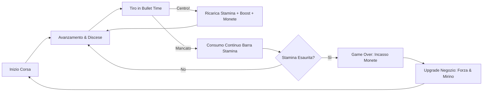

# GAME DESIGN DOCUMENT (GDD)
## Nome Provvisorio: *Sport Climb & Hoop* (oppure *Quidditch Sprint*)
**Piattaforma Target:** Android (Google Play Store)  
**Motore di Sviluppo:** Godot Engine 4 (2D Nativo - GDScript / C#)  
**Target:** Casual / Arcade Mobile Players  
**Autore:** Studente di Ingegneria Informatica  

---

## 1. Executive Summary & Vision

### 1.1 Il Pitch in una frase
Un physics-runner arcade 2D che fonde la progressione su terreni accidentati in stile *Hill Climb Racing* con la precisione aerea del tiro ai cerchi in stile *Quidditch* e l'ascesa verticale di *Doodle Jump*, arricchito da una meccanica di mira in *Bullet Time* e upgrade mirati di **Forza** e **Mirino**.

### 1.2 Core Pillars
1. **Easy to Learn, Hard to Master:** Comandi one-touch intuitivi basati su drag-and-release con rallentatore.
2. **Fisica Soddisfacente:** Ogni sport ha inerzia, peso e rimbalzi autentici.
3. **Loop di Rischio vs Ricompensa:** Tentare canestri minuscoli o posizionati in punti critici garantisce turbo extra e moltiplicatori monete, a rischio di sprecare tempo prezioso.
4. **Progressione Immediata:** Pochi upgrade chiari (Forza e Mirino) con impatto immediato sulle prestazioni della corsa.

---

## 2. Core Gameplay Loop



### 2.1 Movimento e Terreno (Orizzontale + Verticale)
- **Scorrimento Terreno:** Il personaggio avanza automaticamente (o con acceleratore/slancio) su colline e vallate ondulate 2D.
- **Torri ed Elevazioni (Stile Doodle Jump):** In determinati punti della mappa, il giocatore incontra sequenze verticali di cerchi/porte: inanellare canestri in sequenza catapulta il personaggio verso l'alto superando pareti rocciose o dirupi altrimenti insormontabili.
- **Barra Stamina / Slancio (Condizione di Sconfitta):**
  - La barra cala inesorabilmente col passare dei secondi (simile al carburante di *Hill Climb Racing*).
  - Fare canestro/goal ricarica una porzione di barra e fornisce un'accelerazione istantanea (boost).
  - Se la barra si svuota completamente prima del bersaglio successivo, il personaggio si arresta e la partita termina.

### 2.2 Sistema di Tiro: Bullet Time
- **Touch & Drag:** Non appena il giocatore tocca lo schermo e trascina il dito, il tempo di gioco rallenta all'80% (*Bullet Time*).
- **Traiettoria:** Viene visualizzata una traiettoria parabolica tratteggiata che calcola in tempo reale la fisica della palla in base a gravità e velocità corrente del personaggio.
- **Rilascio:** Al sollevamento del dito il tempo torna normale e la palla viene scagliata verso il bersaglio.

---

## 3. Discipline Sportive & Ambientazioni

Ogni sport introduce un'ambientazione tematica e una fisica distinta:

| Sport | Ambientazione & Sfondo | Tipo di Bersaglio | Fisica della Palla | Meccanica Tipica |
| :--- | :--- | :--- | :--- | :--- |
| **Basket** | Playground cittadino / Rucker Park su colline urbane | Canestri orizzontali ad anello con retina | Elastica, rimbalzi vivaci sui tabelloni | Canestri da sopra o tiri di sponda su ostacoli |
| **Calcio** | Prato ondulato / Campi sterrati da periferia | Porte verticali o anelli a rete con portieri/sagome | Pesante, traiettoria parabolica pronunciata | Tiri potenti e passaggi a scavalcare ostacoli |
| **Tennis** | Campi in terra rossa / Erba collinare | Reti tese, bersagli rettangolari ad angolo | Palla leggera e rapidissima | Traiettorie tese o pallonetti precisi sopra le reti |

---

## 4. La Sfida: "Gravità e Dimensione"

### 4.1 Variazioni Dimensionali dei Bersagli
Lungo il tragitto appaiono bersagli di taglie differenti:
1. **Bersaglio Standard (1.0x):** Taglia classica, ricarica normale di stamina e monete base.
2. **Bersaglio Gigante (1.6x):** Molto facile da centrare, ideale per salvarsi in extremis quando la stamina è quasi a zero.
3. **Bersaglio Micro (0.5x):** Estremamente compatto e sfidante; ricompensa il giocatore con:
   - Moltiplicatore combo $2\times$ o $3\times$.
   - **Mega-Boost:** Il personaggio ottiene un'onda d'urto che lo proietta in avanti ad altissima velocità.

### 4.2 Interazione con la Gravità
- Le colline e le pendenze alterano la velocità angolare e la spinta iniziale al momento del tiro.
- Tiri eseguiti mentre si è in fase di salto da una collina subiscono l'inerzia vettoriale del personaggio (vettore velocità $V_{risultante} = V_{personaggio} + V_{tiro}$).

---

## 5. Progressione & Economia di Gioco (Meta-Game)

Per mantenere il progetto snello e realizzabile, il sistema di upgrade è focalizzato su due sole caratteristiche:

### 5.1 Upgrade Personaggio
1. **Forza (Power):**
   - *Livello 1 $\rightarrow$ Livello 10*
   - Aumenta la velocità di uscita della palla ($V_0$).
   - Aumenta l'intensità del boost di velocità conferito al personaggio dopo ogni canestro riuscito.
2. **Mirino (Aim / Trajectory Line):**
   - *Livello 1 $\rightarrow$ Livello 10*
   - Livello basso: linea di mira corta (mostra solo il primo metro di traiettoria).
   - Livello alto: linea di mira estesa e precisa, con indicazione del primo rimbalzo e marker predittivo sul canestro.

### 5.2 Valuta di Gioco: Monete
- Raccolte lungo il tracciato su colline e vallate.
- Ottenute come premio al superamento di canestri (con bonus speciali per combo e bersagli micro).
- Utilizzate nell'officina/spogliatoio per acquistare i livelli di Forza e Mirino.

---

## 6. Direzione Artistica e UI/UX

- **Stile Visivo:** 2D Flat / Cartoon pulito con palette sature e linee nitide (ispirato ad *Alto's Adventure* e *Hill Climb Racing*).
- **Prospettiva:** Laterale 2D (Side-scrolling) con parallasse multistrato (cielo, sagome di stadi/città in lontananza, colline in primo piano).
- **Interfaccia Utente (HUD):**
  - Barra Stamina in alto al centro (colore verde $\rightarrow$ giallo $\rightarrow$ rosso lampeggiante).
  - Contatore Metri percorsi e Monete in alto a sinistra/destra.
  - Indicatore di combo attivo (es. `x2`, `x3! FIRE!`).

---

## 7. Architettura Tecnica in Godot 4

### 7.1 Albero dei Nodi Principale
```text
MainScene (Node2D)
├── ParallaxBackground (Sfondi sportivi a strati)
├── TerrainManager (Generatore procedurale 2D con Line2D + StaticBody2D)
├── TargetSpawner (Instanzia canestri/porte di dimensioni variabili a quote diverse)
├── Player (CharacterBody2D)
│   ├── Sprite2D (Atleta Flat)
│   ├── CollisionShape2D
│   ├── TrajectoryLine (Line2D per il mirino)
│   └── Camera2D (Insegue il player con smoothing)
├── BallPool (Node per il riciclo efficiente di RigidBody2D senza garbage collection)
└── UILayer (CanvasLayer)
    ├── HUD (Barra Stamina, Monete, Metri)
    └── UpgradeModal (Pannello acquisto Forza/Mirino)
```

### 7.2 Script Chiave
- `PlayerController.gd`: Gestione del movimento orizzontale, fisica su pendii, rallentatore temporale (`Engine.time_scale = 0.2`).
- `Ball.gd`: `RigidBody2D` con `PhysicsMaterial` differenziato (Bounciness elevata per Basket, attrito e massa per Calcio).
- `TrajectoryPredictor.gd`: Funzione matematica predittiva per tracciare i punti della parabola:
  $$\vec{P}(t) = \vec{P}_0 + \vec{V}_0 t + \frac{1}{2} \vec{g} t^2$$
- `SaveSystem.gd`: Salvataggio locale in formato JSON criptato (`user://save_game.dat`) di monete e livelli di upgrade.

---

## 8. Roadmap di Produzione (Iterativa)

### Sprint 1: Prototipo Core Physics (Settimana 1)
- [ ] Creazione del progetto Godot 4.
- [ ] Implementazione del tiro con drag & release + time dilation (Bullet Time).
- [ ] Disegno della parabola del mirino (`Line2D`).
- [ ] Creazione del canestro di test con `Area2D` per rilevare il passaggio palla.

### Sprint 2: Terreno e Barra Stamina (Settimana 2)
- [ ] Generazione del terreno collinare continuo (curve spline o segmenti 2D).
- [ ] Barra stamina che cala nel tempo.
- [ ] Spinta turbo e ricarica stamina al canestro.
- [ ] Canestri a quote elevate (scale verticali stile Doodle Jump).

### Sprint 3: Sport, Bersagli Variabili e Upgrade (Settimana 3)
- [ ] Canestri Grandi vs Micro con moltiplicatori.
- [ ] Switch tra i 3 sport (Basket, Calcio, Tennis) con fisica e sprite dedicati.
- [ ] Sistema di monete e menu Upgrade per Forza e Mirino.

### Sprint 4: Google Play Store Polish & Rilascio (Settimana 4)
- [ ] Grafica Flat Cartoon definitiva e audio/SFX d'impatto (rimbalzi, retina che fruscia, boost).
- [ ] Esportazione Android (`.aab`) con Keystore di produzione.
- [ ] Configurazione scheda Google Play Console.
- [ ] Avvio del Closed Testing con i 20 tester richiesti da Google per 14 giorni.
