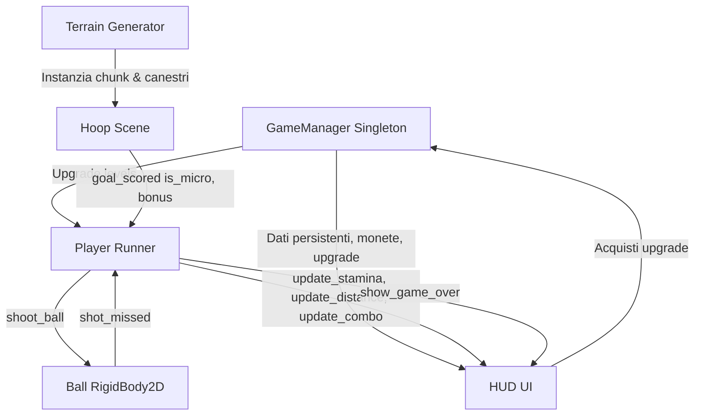

# SKY HOOPS — ARCHITECTURE & PROJECT MAP

> **Scopo di questo file**: Questa mappa è la fonte di verità architetturale per lo sviluppo e l'evoluzione di *Sky Hoops*.
> Viene consultata prima di ogni intervento e aggiornata dopo ogni modifica strutturale per garantire efficienza, zero scansioni ridondanti e zero regressioni.

---

## 1. PANORAMICA & CONFIGURAZIONE PROGETTO
- **Engine**: Godot 4.x (Compatibility Renderer per mobile performance e rendering web-ready).
- **Risoluzione di Riferimento**: 1280×720 (Landscape), Stretch Mode: `canvas_items` / `expand`.
- **Genere**: 2D Mobile Endless Runner × Arcade Basketball.
- **Stage Attuale**: Green Hills (terreno procedurale a chunk continui).
- **Percorso Root Progetto**: `sky-hoops/`.

---

## 2. MAPPA DEI FILE & RESPONSABILITÀ

```
sky-hoops/
├── project.godot                     # Impostazioni engine, autoload (GameManager), layer di collisione
├── MAPPING.md                        # Questa mappa architetturale
├── assets/                           # Risorse grafiche vettoriali (SVG)
│   ├── coin.svg                      # Icona moneta oro ad alta risoluzione
│   ├── player_runner.svg             # Sprite atleta runner (corpo slanciato, sneakers rosse)
│   ├── basketball.svg                # Texture realistica del pallone da basket
│   ├── hoop.svg                      # Tabellone, ferro e retina del canestro
│   └── spike.svg                     # Ostacoli aculei a terra
├── scenes/
│   ├── game.tscn                     # Scena principale di gameplay (assembla Player, Terrain, Camera, HUD)
│   ├── main_menu.tscn                # Menu iniziale, selezione shop/upgrade, record
│   ├── hud.tscn                      # Overlay UI in-game (stamina, monete, combo on fire, controlli touch, game over)
│   ├── player.tscn                   # CharacterBody2D del giocatore runner con visual palla e luci
│   ├── hoop.tscn                     # Canestro interattivo (Area2D goal + corpi statici ferro/tabellone)
│   ├── ball.tscn                     # RigidBody2D pallone tirato dal giocatore
│   ├── bird.tscn                     # Uccello in volo (bersaglio per Trick Shot "Off the bird")
│   ├── coin.tscn                     # Moneta raccoglibile lungo il percorso
│   ├── obstacle_spike.tscn           # Ostacolo spuntoni (danno stamina + flash rosso)
│   ├── pickup_energy.tscn            # Energy drink raccoglibile (ricarica stamina)
│   ├── trajectory_dots.tscn          # Visualizzazione parabolica dei punti di mira
│   └── background.tscn               # Sfondo parallax a strati (cielo, nuvole, colline)
└── scripts/
    ├── game_manager.gd               # AUTOLOAD SINGLETON: salvataggi, wallet, upgrade, record, haptics
    ├── player.gd                     # Fisica runner, palleggio realistico, mira drag/button, slam dunk, combo
    ├── terrain_generator.gd          # Generazione chunk procedurali continui, spawn canestri/ostacoli/oggetti
    ├── hoop.gd                       # Fisica retina (swish), punteggio, floating text, flash luminoso
    ├── ball.gd                       # RigidBody2D palla, squash & stretch su rimbalzo, emissione shot_missed
    ├── hud.gd                        # Controller UI, stamina dinamica a 3 colori, On Fire popup, menu Game Over
    ├── main_menu.gd                  # Logica menu di avvio e upgrade iniziali
    ├── trajectory_dots.gd            # Gestione pool e rendering della traiettoria di tiro
    └── background.gd                 # Movimento parallax sincronizzato con la camera
```

---

## 3. MATRICE DELLE COLLISIONI (COLLISION LAYERS & MASKS)

| Layer ID | Nome Layer | Oggetti Associati | Collision Mask (con chi collidono) | Note Architetturali |
| :--- | :--- | :--- | :--- | :--- |
| **Layer 1** | `Terrain` | Terreno procedurale (`StaticBody2D` in `chunk`) | Mask: `1` | Poligono chiuso solido fino a $y=1800$ per consentire il floor snap |
| **Layer 2** | `Player` | `player.tscn` (`CharacterBody2D`) | Mask: `1` (Terreno) | **Non collidere MAI con Layer 8** (evita incastri durante la schiacciata) |
| **Layer 3** | `Obstacles` | Spuntoni (`Area2D`), Uccelli | Mask: `2` (Player), `9` (Ball) | Attivano danno o trick shot |
| **Layer 4** | `Collectibles`| Monete, Energy Drink (`Area2D`) | Mask: `2` (Player) | Raccolta al passaggio del player |
| **Layer 8** | `Hoop` | Ferro e Tabellone (`StaticBody2D` in `hoop.tscn`)| Mask: `0` (Non rilevano fisicamente il player) | Solo la palla vi rimbalza contro |
| **Layer 9** | `Ball` | `ball.tscn` (`RigidBody2D`) | Mask: `1` (Terreno) + `8` (Ferro/Tabellone) | Maschera $= 1 + 8 = 9$. Rimbalza su ferro e terra |

---

## 4. FLUSSO DEI DATI, SEGNALI & STATO



- **Ciclo On Fire**:
  - `trigger_boost`: Ogni canestro riuscito fa `combo_count += 1`, attiva `is_on_fire = true`, raddoppia le monete guadagnate ($2\times$) e aggiorna l'HUD.
  - `shot_missed`: Emesso da `ball.gd` se tocca il terreno (`layer 1`) o cade fuori schermo ($y > 780$) prima di fare canestro. Reset immediato della combo (`combo_count = 0`, `is_on_fire = false`).
  - La serie **non** scade con un timer tra un canestro e l'altro, ma vive fino al primo errore.

---

## 5. REGOLE D'ORO & GOTCHAS TECNOLOGICI (DA NON DIMENTICARE)

1. **Focus dei Pulsanti UI (`Control.FOCUS_NONE`)**:
   - Tutti i pulsanti in `hud.tscn` (`JumpButton`, `ShootButton`, `PauseButton`, upgrade buttons) devono avere `focus_mode = 0`.
   - Se un pulsante trattiene il focus, la pressione della barra spaziatrice viene intercettata da `ui_accept` invece che eseguire il salto/tiro del player.
2. **Continuità del Terreno Procedurale**:
   - I chunk hanno larghezza fissa $1200\text{ px}$. Il passo orizzontale dei vertici **deve** essere un divisore esatto di 1200 (`step_x = 24.0`).
   - I poligoni di collisione devono usare `build_mode = BUILD_SOLIDS` con fondo chiuso a $y = 1800$. I segmenti aperti (`BUILD_SEGMENTS`) rompono il calcolo dei vettori normali di `floor_snap_length` in Godot 4 provocando il galleggiamento del player in discesa.
3. **Bullet Time & Hitstop Timers**:
   - `Engine.time_scale` rallenta la simulazione durante la mira ($0.2$) o l'impatto della schiacciata ($0.08$).
   - I timer dedicati all'uscita dal freeze frame devono usare `get_tree().create_timer(duration, true, false, true)` (quarto argomento `ignore_time_scale = true`) per non bloccarsi indefinitamente.
4. **Grafica Vettoriale e Icone UI**:
   - Non usare emoji unicode (es. `🪙`) per valute e asset di gioco. Usare sempre `res://assets/coin.svg` tramite `TextureRect` (`expand_mode = 1`, `stretch_mode = 5`) o tramite tag BBCode `[img=16]res://assets/coin.svg[/img]` nei nodi `RichTextLabel`.
5. **Condizioni Slam Dunk (Schiacciata)**:
   - Si attiva solo se il player è in volo, entro $dx \in [-15, 85]\text{ px}$, $dy \in [-130, 130]\text{ px}$ e la palla si trova fisicamente al di sopra del ferro (`ball_visual.y < hoop.y - 10`).
   - La schiacciata esegue una piroetta a 360° e scavalca il ferro atterrando oltre il tabellone a $x + 55\text{ px}$.
