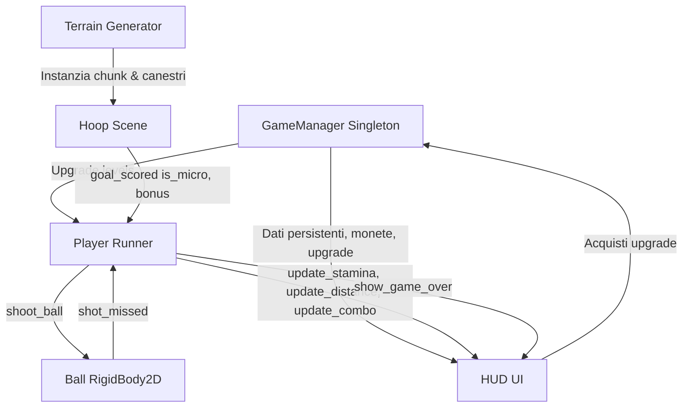

# SKY HOOPS — ARCHITECTURE & PROJECT MAP

> **Scopo di questo file**: Questa mappa è la fonte di verità architetturale per lo sviluppo e l'evoluzione di *Sky Hoops*.
> Viene consultata prima di ogni intervento e aggiornata dopo ogni modifica strutturale per garantire efficienza, zero scansioni ridondanti e zero regressioni.

---

## 1. PANORAMICA & CONFIGURAZIONE PROGETTO
- **Engine**: Godot 4.x (Compatibility Renderer per mobile performance e rendering web-ready).
- **Risoluzione di Riferimento**: 1280×720 (Landscape), Stretch Mode: `canvas_items` / `expand`.
- **Genere**: 2D Mobile Endless Runner × Arcade Basketball.
- **Stage Attuale**: Green Hills (terreno procedurale a chunk continui).
- **Percorso Root Progetto**: `sky-hoops/`.

---

## 2. MAPPA DEI FILE & RESPONSABILITÀ

```
sky-hoops/
├── project.godot                     # Impostazioni engine, autoload (GameManager), layer di collisione
├── MAPPING.md                        # Questa mappa architetturale
├── assets/                           # Risorse grafiche vettoriali (SVG)
│   ├── coin.svg                      # Icona moneta oro ad alta risoluzione
│   ├── player_runner.svg             # Sprite atleta runner stile caricatura "Dunk City"
│   ├── player_rig/                   # Componenti modulari dello scheletro 2D (Skeletal Cutout)
│   │   ├── torso.svg                 # Canotta Royal Blue "Dunk 7 City", bordi oro, pantaloncini blu
│   │   ├── head.svg                  # Testa caricatura espressiva: capelli spiky, fascia bianca, sudore, sorriso con denti
│   │   ├── thigh_front.svg           # Coscia muscolosa con ginocchiera sportiva nera (knee pad)
│   │   ├── shin_front.svg            # Polpaccio, calzino bianco a doppie strisce blu e sneaker chunky da basket
│   │   ├── thigh_back.svg            # Coscia posteriore in ombra con ginocchiera nera
│   │   ├── shin_back.svg             # Polpaccio e sneaker posteriore scura con suola bianca
│   │   ├── arm_upper_front.svg       # Spalla e bicipite muscoloso con goccia di sudore
│   │   ├── arm_forearm_front.svg     # Avambraccio con guanto nero da basket fingerless e inserto oro
│   │   └── arm_back.svg              # Braccio posteriore con guanto nero fingerless
│   ├── basketball.svg                # Texture realistica del pallone da basket
│   ├── hoop.svg                      # Tabellone, ferro e retina del canestro
│   └── spike.svg                     # Ostacoli aculei a terra
├── scenes/
│   ├── game.tscn                     # Scena principale di gameplay (assembla Player, Terrain, Camera, HUD)
│   ├── main_menu.tscn                # Menu iniziale, selezione shop/upgrade, record
│   ├── hud.tscn                      # Overlay UI in-game (stamina, monete, combo on fire, controlli touch, game over)
│   ├── player.tscn                   # CharacterBody2D del runner: Rig scheletrico 2D + AnimationPlayer + palla
│   ├── hoop.tscn                     # Canestro interattivo (Area2D goal + corpi statici ferro/tabellone)
│   ├── ball.tscn                     # RigidBody2D pallone tirato dal giocatore
│   ├── bird.tscn                     # Uccello in volo (bersaglio per Trick Shot "Off the bird")
│   ├── coin.tscn                     # Moneta raccoglibile lungo il percorso
│   ├── obstacle_spike.tscn           # Ostacolo spuntoni (danno stamina + flash rosso)
│   ├── pickup_energy.tscn            # Energy drink raccoglibile (ricarica stamina)
│   ├── trajectory_dots.tscn          # Visualizzazione parabolica dei punti di mira
│   └── background.tscn               # Sfondo parallax a strati (cielo, nuvole, colline)
└── scripts/
    ├── game_manager.gd               # AUTOLOAD SINGLETON: salvataggi, wallet, upgrade, record, haptics
    ├── player.gd                     # Fisica runner, palleggio realistico, mira drag/button, slam dunk, combo
    ├── terrain_generator.gd          # Generazione chunk procedurali continui, spawn canestri/ostacoli/oggetti
    ├── hoop.gd                       # Fisica retina (swish), punteggio, floating text, flash luminoso
    ├── ball.gd                       # RigidBody2D palla, squash & stretch su rimbalzo, emissione shot_missed
    ├── hud.gd                        # Controller UI, stamina dinamica a 3 colori, On Fire popup, menu Game Over
    ├── main_menu.gd                  # Logica menu di avvio e upgrade iniziali
    ├── trajectory_dots.gd            # Gestione pool e rendering della traiettoria di tiro
    └── background.gd                 # Movimento parallax sincronizzato con la camera
```

---

## 3. MATRICE DELLE COLLISIONI (COLLISION LAYERS & MASKS)

| Layer ID | Nome Layer | Oggetti Associati | Collision Mask (con chi collidono) | Note Architetturali |
| :--- | :--- | :--- | :--- | :--- |
| **Layer 1** | `Terrain` | Terreno procedurale (`StaticBody2D` in `chunk`) | Mask: `1` | Poligono chiuso solido fino a $y=1800$ per consentire il floor snap |
| **Layer 2** | `Player` | `player.tscn` (`CharacterBody2D`) | Mask: `1` (Terreno) | **Non collidere MAI con Layer 8** (evita incastri durante la schiacciata) |
| **Layer 3** | `Obstacles` | Spuntoni (`Area2D`), Uccelli | Mask: `2` (Player), `9` (Ball) | Attivano danno o trick shot |
| **Layer 4** | `Collectibles`| Monete, Energy Drink (`Area2D`) | Mask: `2` (Player) + `Ball` | Raccolta sia al passaggio del player sia al tocco della palla tirata |
| **Layer 8** | `Hoop` | Ferro e Tabellone (`StaticBody2D` in `hoop.tscn`)| Mask: `0` (Non rilevano fisicamente il player) | Solo la palla vi rimbalza contro |
| **Layer 9** | `Ball` | `ball.tscn` (`RigidBody2D`) | Mask: `1` (Terreno) + `8` (Ferro/Tabellone) | Maschera $= 1 + 8 = 9$. Rimbalza su ferro e terra |

---

## 4. FLUSSO DEI DATI, SEGNALI & STATO



- **Struttura dei Potenziamenti (Officina & Game Over)**:
  - 4 Statistiche scalabili su **10 Livelli** (Costi: $100 \times 2^{\text{level}-1}$, da 100 a 51.200 monete):
    - **VELOCITÀ (`speed_level`)**: Incrementa la velocità di corsa base del runner ($280 \rightarrow 460\text{ px/s}$) e la velocità in boost ($500 \rightarrow 788\text{ px/s}$), accelerando proporzionalmente anche la cadenza dei passi dell'animazione.
    - **MIRINO (`aim_level`)**: Incrementa il numero di punti guida visibili nella traiettoria balistica di tiro ($2 \rightarrow 10$ punti).
    - **SALTO (`jump_level`)**: Incrementa l'elevazione e spinta del salto ($480 \rightarrow 768\text{ px/s}$).
    - **STAMINA (`stamina_level`)**: Incrementa la riserva di energia ($100 \rightarrow 280$) e ne riduce il consumo progressivo.
  - 3 Abilità Speciali sbloccabili (5.000 / 10.000 / 20.000 monete): Calamita, Stamina 1000m, Volo Aereo 1000m.

- **Ciclo On Fire & Moltiplicatore Canestri Consecutivi (fino a x=5)**:
  - `trigger_boost`: Ogni canestro riuscito con tiri consecutivi fa `combo_count += 1`, attiva `is_on_fire = true`, intensifica le fiamme dell'atleta e calcola il moltiplicatore progressivo $x = \text{clamp}(\text{streak}, 1, 5)$.
  - **Moltiplicatore Canestri Consecutivi ($1 \rightarrow 5\text{x}$)**:
    - 1° Canestro ($x=1$): Punteggio base standard.
    - 2° Canestro consecutivo ($x=2$): Monete $\times 2$ (Attivazione bordo infuocato `fire_border`).
    - 3° Canestro consecutivo ($x=3$): Monete $\times 3$.
    - 4° Canestro consecutivo ($x=4$): Monete $\times 4$.
    - 5°+ Canestro consecutivo ($x=5$): Monete $\times 5$ (**MAX FIRE! 🔥🔥🔥**).
  - **Valore Base Canestri e Moltiplicazione a Streak Pieno ($x=5$)**:
    - Bank Shot: base 25 🪙 $\rightarrow$ fino a **125 🪙** a x5
    - Perfect Swish: base 35 🪙 $\rightarrow$ fino a **175 🪙** a x5
    - Micro Swish: base 45 🪙 $\rightarrow$ fino a **225 🪙** a x5
    - Trick Shot (rimbalzo): base 50 🪙 $\rightarrow$ fino a **250 🪙** a x5
    - Off The Bird: base 55 🪙 $\rightarrow$ fino a **275 🪙** a x5
    - Slam Dunk: base 65 🪙 $\rightarrow$ fino a **325 🪙** a x5
  - Anche le monete raccolte a terra e in volo lungo il percorso ereditano il moltiplicatore corrente ($x = 1 \dots 5$).
  - `shot_missed`: Emesso da `ball.gd` se un tiro tocca terra (`layer 1`), cade fuori schermo ($y > 780$) o scade senza andare a segno. Reset immediato della combo (`combo_count = 0`, `is_on_fire = false`, disattivazione bordo infuocato e ripristino moltiplicatore a $x=1$).
  - **Disposizione Monete (Archi Guidati & Raccolta con Palla)**:
    - Le monete non fluttuano a caso sul terreno: compaiono *esclusivamente* come **arco di salto sopra i burroni** (5 monete) o come **traiettoria balistica di tiro su alcuni canestri** (~45% dei canestri, garantito al primo canestro introduttivo).
    - Le monete sono raccoglibili **sia dal runner sia dal pallone da basket** in volo: al contatto con la palla, si disattivano istantaneamente con scintillii dorati e accreditano le monete alla partita.
  - **Disposizione Spuntoni/Mine & Ricariche Stamina**:
    - Funzione `get_safe_ground_x`: garantisce che nessun ostacolo o pickup energetico compaia mai nel vuoto sopra un burrone.
    - Gli spuntoni/mine si allineano alla pendenza del terreno (`get_terrain_slope_angle`) e hanno frequenza elevata (65% base + 35% doppio ostacolo), risultando oltre 6 volte più frequenti delle ricariche di stamina (ridotte al 12% oltre 1000m).
  - `shot_missed`: Emesso da `ball.gd` se tocca il terreno (`layer 1`) o cade fuori schermo ($y > 780$) prima di fare canestro. Reset immediato della combo (`combo_count = 0`, `is_on_fire = false`).
  - La serie **non** scade con un timer tra un canestro e l'altro, ma vive fino al primo errore.

---

## 5. REGOLE D'ORO & GOTCHAS TECNOLOGICI (DA NON DIMENTICARE)

1. **Focus dei Pulsanti UI (`Control.FOCUS_NONE`)**:
   - Tutti i pulsanti in `hud.tscn` (`JumpButton`, `ShootButton`, `PauseButton`, upgrade buttons) devono avere `focus_mode = 0`.
   - Se un pulsante trattiene il focus, la pressione della barra spaziatrice viene intercettata da `ui_accept` invece che eseguire il salto/tiro del player.
2. **Continuità del Terreno Procedurale**:
   - I chunk hanno larghezza fissa $1200\text{ px}$. Il passo orizzontale dei vertici **deve** essere un divisore esatto di 1200 (`step_x = 24.0`).
   - I poligoni di collisione devono usare `build_mode = BUILD_SOLIDS` con fondo chiuso a $y = 1800$. I segmenti aperti (`BUILD_SEGMENTS`) rompono il calcolo dei vettori normali di `floor_snap_length` in Godot 4 provocando il galleggiamento del player in discesa.
3. **Bullet Time & Hitstop Timers**:
   - `Engine.time_scale` rallenta la simulazione durante la mira ($0.2$) o l'impatto della schiacciata ($0.08$).
   - I timer dedicati all'uscita dal freeze frame devono usare `get_tree().create_timer(duration, true, false, true)` (quarto argomento `ignore_time_scale = true`) per non bloccarsi indefinitamente.
4. **Grafica Vettoriale e Icone UI**:
   - Non usare emoji unicode (es. `🪙`) per valute e asset di gioco. Usare sempre `res://assets/coin.svg` tramite `TextureRect` (`expand_mode = 1`, `stretch_mode = 5`) o tramite tag BBCode `[img=16]res://assets/coin.svg[/img]` nei nodi `RichTextLabel`.
5. **Condizioni Slam Dunk (Schiacciata)**:
   - Si attiva solo se il player è in volo, entro $dx \in [-20, 105]\text{ px}$, $dy \in [-145, 145]\text{ px}$ e la palla si trova fisicamente al di sopra del ferro (`ball_visual.y < hoop.y - 10`).
   - La schiacciata esegue una piroetta a 360° e scavalca il ferro atterrando oltre il tabellone a $x + 65\text{ px}$.
6. **Animazione Scheletrica 2D & Palleggio Realistico**:
   - Il player usa una gerarchia `Rig` (`Node2D`) con componenti modulari SVG ad alta definizione in `assets/player_rig/`.
   - Scala base atleta: `Vector2(0.75, 0.75)` (150% della scala originale per massima leggibilità su schermo 720p/1080p).
   - Scala pallone da basket: `Vector2(0.40, 0.40)` (perfettamente identica a `ball.tscn`).
   - `AnimationPlayer` controlla i cicli `run`, `jump`, `fall`, `dunk`, `idle` con interpolazione fluida a 60 FPS.
   - **Regola Basket Palleggio vs Salto**: Il palleggio rimbalzato a terra è attivo **esclusivamente a contatto con il suolo**. Appena il corridore stacca i piedi per un salto, super salto su molla o caduta (`not is_on_floor() or has_jumped_in_air`), il palleggio si interrompe all'istante: la palla viene raccolta e serrata saldamente a due mani al petto/mento (`Vector2(24, -28)`).
   - **Stabilizzazione Braccio/Mano Destra in Salto**: Sia nelle tracce di animazione `Animation_jump` e `Animation_fall` in `player.tscn`, sia nel ciclo `_process` di `player.gd`, il braccio anteriore (`FrontArm`, rotazione fissa `0.384 rad`), l'avambraccio (`ForearmFront`, rotazione `0.2618 rad`) e il braccio posteriore (`BackArm`, rotazione `-0.1047 rad`) rimangono saldamente ancorati e poggiati sopra il pallone raccolto al petto senza compiere oscillazioni o palleggi spuri in aria. La velocità di animazione in aria è fissata a `speed_scale = 1.0` (invece di accelerare con la velocità al suolo). All'atterraggio, l'animazione `run` riprende fluidamente il palleggio sincronizzato.
   - Il braccio posteriore (`BackArm`) è orientato verso la spalla posteriore: i suoi track di rotazione sono sincronizzati in fase controlaterale con `FrontLeg` (oscillazione coordinata con la falcata della corsa, slancio in elevazione su salto/dunk).
   - La cadenza della corsa si adatta dinamicamente: `anim_player.speed_scale = (current_speed / base_speed) * 1.15`.
   - L'inclinazione su salite e discese è gestita con `lerp_angle(rotation, floor_normal.angle() + PI / 2.0, 14.0 * delta)`.
7. **Fisica Molleggiata del Ferro, Retina e Slam Dunk (Juice)**:
   - All'impatto (`hoop.gd`), il ferro subisce una deflessione elastica smorzata verso il basso (+20px su dunk, +8px su tiro) con inclinazione e svasatura a campana della retina (`trigger_rim_juice`), accompagnata da shockwave radiale luminosa.
   - La schiacciata include hang-time a due mani sul ferro, estrazione a 920 px/s, rotazione 360° fluida e ripresa della corsa con velocità maggiorata.
8. **Ciclo Dinamico Giorno / Tramonto / Notte & Pista Illuminata**:
   - `background.gd` gestisce 4 fasi continue: Giorno (0-350m), Tramonto Dorato (350-900m), Crepuscolo (900-1600m), Notte Stellata (1600m+).
   - Oltre 600m il tracciato genera lampioni da stadio (`spawn_floodlight_in_chunk`) con `PointLight2D` a terra e l'erba adotta una pigmentazione verde smeraldo ad altissima luminescenza per garantire perfetta visibilità e leggibilità di buche e ostacoli.
9. **Traguardo Record Personale su Terreno**:
   - `terrain_generator.gd` posiziona una linea d'arrivo fisica riflettente e un'insegna aerea `"🏆 RECORD: {M}m 🏁"` a `GameManager.high_score * 50.0`.
   - Al passaggio del giocatore si attiva una cascata di coriandoli multicolore (`CPUParticles2D`), vibrazione aptica e banner celebrativo.
10. **Micro Slow-Motion Cinematico (Buzzer Beater & Schiacciate)**:
    - `Engine.time_scale` rallenta a 0.12 - 0.22 per 0.10s con camera zoom-punch (1.08x - 1.12x) e rientro morbido a 1.0 su schiacciate, trick shot, bird shot e canestri in emergenza stamina.
11. **Riprogettazione Ricompensa Post-Canestro: Ricarica Stamina +20% & Aura Dorata Immune**:
    - **Rimozione Boost Velocità**: Eliminata la brusca accelerazione orizzontale post-canestro (`trigger_boost`) che penalizzava la precisione dei salti e causava cadute premature. La velocità di corsa resta stabile e governabile a `base_speed`.
    - **Ricarica Stamina +20%**: Ogni canestro o schiacciata ripristina istantaneamente il 20% della stamina massima con animazione di flash verde dell'HUD (`flash_stamina_heal`) e notifica testuale fluttuante.
    - **Aura Dorata Protettiva (Immunità Totale a Trappole per 3.5s - 5.0s)**:
      - Attiva l'alone sacro rotante in `assets/golden_aura.svg`, particelle stellari dorate e `PointLight2D` calda.
      - **Fisica Runner Pulita a Terra**: Rimosso l'artificioso planaggio/hovering aereo che sollevava il corridore e causava disallineamenti con le pendenze. Il corridore corre normalmente a contatto con l'erba (`is_on_floor() == true`), conservando il palleggio e le animazioni naturali.
      - **Immunità Totale alle Trappole**: A contatto con spuntoni (`obstacle_spike.gd`), l'aura disintegra istantaneamente l'ostacolo con pop-up `"✨ AURA IMMUNE! 🛡️"` e 0 danni alla stamina. Sulle sagome difensive (`defender_dummy.gd`), l'atleta le travolge e posterizza disintegrandole.
      - **Zero Salti Doppi Aerei**: Rimosso qualsiasi salto mid-air. Il salto richiede aderenza al terreno o la finestra di Coyote Time (0.10s), impedendo categoricamente doppi salti involontari a mezz'aria.
12. **Difficoltà Progressiva: Burroni Scalati per Distanza (Feature 3), Canestri Mobili (Feature 4) e Velocità Progressiva Fluida**:
    - **Velocità Progressiva Morbida (`player.gd`)**:
      - La velocità di corsa aumenta gradualmente e dolcemente con la distanza: `+15 px/s ogni 500m` (`min(distance_m * 0.03, 70.0)`).
      - Tetto massimo fissato a `base_speed + 70.0 px/s` (circa 350 px/s), garantendo una sfida reattiva ma mai incontrollabile o impossibile.
    - **Burroni Calibrati e Meno Punitivi (`terrain_generator.gd`)**:
      - `0 - 80m`: 0% burroni (fase iniziale sicura).
      - `80 - 350m`: 22% burroni, larghezza (130 - 155px).
      - `350 - 800m`: 28% burroni, larghezza (145 - 170px).
      - `800m+`: 32% max burroni, larghezza sempre accessibile (160 - 185px).
    - **Canestri Mobili & Sfide di Tiro Evolute (`hoop.gd` e `terrain_generator.gd`)**:
      - `0 - 500m`: Canestri statici, quota atletica rialzata (310 - 365px), 35% traiettorie guida di monete (3 monete ad arco).
      - `500 - 1000m`: 35% canestri oscillanti verticali (ampiezza 30-48px, velocità 1.6-2.2), 20% micro-canestri, quota (335 - 400px), 22% monete guida.
      - `1000 - 1600m`: 60% canestri oscillanti (con 40% moto ellittico X+Y), 35% micro-canestri, quota (355 - 430px), 14% monete guida.
      - `1600m+`: 80% canestri mobili (50% moto ellittico dinamico con luce ciano pulsante), 45% micro-canestri, quota estrema (375 - 460px / micro 425 - 510px), 8% monete guida (tiro a istinto puro).
13. **Molle Trampolino (Spring Pads) & Sagome Difensive con Pop-up (Defender Dummy)**:
    - **Molle Trampolino (`spring_pad.tscn`, `spring_pad.gd`, `assets/spring_pad.svg`)**:
      - Spawna sul terreno dopo 400m (32% probabilità).
      - Quando il player ci corre o atterra sopra, comprime la molla e lo lancia in un **Super Salto acrobatico** (`velocity.y = -jump_force * 1.55`, ~750 px/s) con squash & stretch, particelle dorate e testo `"🚀 BOING! SUPER SALTO"`.
      - Se colpita dal pallone, proietta la palla a rimbalzo elevato verso l'alto (`"🏀 MEGA RIMBALZO!"`).
    - **Sagoma Difensiva D-Man (`defender_dummy.tscn`, `defender_dummy.gd`, `assets/defender_dummy.svg`)**:
      - Spawna sul terreno dopo 500m (30-42% probabilità).
      - **Pop-up Prossimità**: Quando il player entra a 240px di distanza, la sagoma scatta verso l'alto con oscillazione elastica della molla e braccia tese al cielo.
      - **Muro Tiri Bassi**: Se il tiro del giocatore è teso e colpisce il corpo o le mani della sagoma, il tiro viene stoppato con forza indietro (`"🚫 STOPPATA! BLOCKED!"`) e scuotimento della camera. Costringe ad usare parabole alte ad arco ("Sky Hook").
      - **Impatto col Giocatore**: Se il corridore ci sbatte a terra senza saltare, perde 12 stamina (`"⚠️ FALLO IN ATTACCO!"`). Se invece ha l'Aura Dorata o la schiaccia dall'alto, travolge e posterizza la sagoma disintegrandola a terra (`"💥 POSTERIZZATO!"`).
14. **Balancing & Bug Fixes (Novembre 2026)**:
    - **Baratri visibili e attivi**: Corretta la soglia d'inizio (da 600m a 80m) per far comparire i baratri nelle normali sessioni di gioco senza dover correre 2 minuti a vuoto.
    - **Altezza Canestri Rialzata ("Sky Hoops")**: Tutti i canestri introduttivi ed endless sono stati ulteriormente rialzati (+45/55px, quote base da 310 a 395px, fino a 510px per i micro aerei nella notte) per valorizzare le parabole di tiro ad arco alto, i salti in elevazione e le molle acrobatiche.
    - **Allargamento Canestri & Risoluzione Micro-Canestri**: I canestri standard sono scalati a `1.10x` (apertura interna ferro ~62px per pallone da 40px) e i micro-canestri sono portati da `0.65x` a `0.85x` (apertura interna ~48px invece di 36px, consentendo finalmente alla palla di entrare fisicamente invece di incastrarsi o rimbalzare all'infinito).
    - **Risoluzione Falsi Canestri su Contatto Esterno**: Ridisegnato il sensore dell'Area2D (`hoop.tscn`, centrato nella retina sotto il ferro a $y=15$) e introdotta una rigorosa validazione a tre condizioni in `hoop.gd`: velocità verticale discendente (`linear_velocity.y > 45.0`), centratura nel cilindro (`rel_x <= 26.0 * scale.x`) e provenienza dall'alto (`global_position.y <= hoop.y + 16.0 * scale.y`), eliminando ogni convalida anomala su sfioramento esterno del ferro o risalita dal basso.
    - **Densità Monete Dimezzata**: Parabole ridotte da 5 a 3 monete, e probabilità di spawn degli archi ridotta drasticamente per evitare sovraffollamento visivo a schermo.
    - **Consumo Stamina Aumentato a Bassi Livelli**: Formula aggiornata a `5.2 / (1.0 + (level - 1) * 0.10)`. Al Livello 1 la stamina cala visibilmente a ~5.2 punti/s (durata ~19s senza canestri), motivando il giocatore a segnare costantemente e valorizzando gli upgrade nello shop.
    - **Risolto Bug Salti Doppi e Planaggio Post-Canestro**: Rimosso completamente il codice di levitazione/planaggio artificiale a quota approssimata che bloccava il runner a mezz'aria, impediva il contatto con il suolo (`is_on_floor() == false`) e causava doppi salti a mezz'aria. Il salto ora richiede contatto con il terreno o l'uso del Coyote Time (0.10s), ripristinando la fisica di corsa e salto naturale, con l'Aura Dorata che agisce come scudo d'invulnerabilità totale a trappole e ostacoli.
15. **Introduzione Onboarding Curata a Mano (0 - 500m) & Raccordo Procedurale Continuo**:
    - **Profilo Altimetrico Ibrido Continuo (`get_terrain_y`)**:
      - `0 - 80m (0 - 4000 px)`: Pianura orizzontale flat a quota `y = 520.0` per consentire al giocatore di prendere piena confidenza con i comandi, il palleggio e la traiettoria di tiro.
      - `80 - 400m (4000 - 20000 px)`: Onde collinari dolci e sinuose con ampiezza contenuta (`520.0 + sin((x - 4000.0) * 0.0025) * 55.0`).
      - `400 - 500m (20000 - 25000 px)`: Raccordo continuo ad accelerazione nulla tramite `smoothstep(20000.0, 25000.0, x)` tra l'onda introduttiva e la formula procedurale completa (`520.0 + sin(x * 0.003) * 90.0 + cos(x * 0.006) * 40.0`).
      - `500m+ (25000 px+)`: Generazione procedurale sinusoidale complessa e infinita.
      - **Pendenza Continua (`get_terrain_slope_angle`)**: Calcolata numericamente mediante differenze finite simmetriche `(y(x+2) - y(x-2)) / 4.0`, garantendo perfetta adesione degli ostacoli e rotazione del runner su qualsiasi transizione.
    - **Progressione Didattica Deterministica dei Primi 21 Chunks (Chunk 0 - 20)**:
      - `Chunk 0 (0 - 24m)`: Piatto, 4 monete di benvenuto a terra.
      - `Chunk 1 (24 - 48m)`: Piatto, 3 monete d'allineamento.
      - `Chunk 2 (48 - 72m)`: **Hoop 1** (primo swish con arco di monete didattico, quota 310px).
      - `Chunk 3 (72 - 96m)`: Inizio ondulazione a 80m, sprint con monete a terra.
      - `Chunk 4 (96 - 120m)`: Prima **Molla Trampolino (Spring Pad 1)** a terra.
      - `Chunk 5 (120 - 144m)`: **Hoop 2 (Sky Basket)** a quota elevata (+395px) raggiungibile col Super Salto.
      - `Chunk 6 (144 - 168m)`: Dosso collinare morbido con monete di passaggio.
      - `Chunk 7 (168 - 192m)`: Primo **Energy Drink** con ricarica stamina e monete.
      - `Chunk 8 (192 - 216m)`: Primo **Baratro (Gap 1)** (140px, salto pulito con parabola guida).
      - `Chunk 9 (216 - 240m)`: Primo **Spuntone** a terra sormontato da arco di monete per suggerire il salto.
      - `Chunk 10 (240 - 264m)`: **Hoop 3** su collina (quota 325px).
      - `Chunk 11 (264 - 288m)`: Tratto di corsa e monete.
      - `Chunk 12 (288 - 312m)`: Prima **Sagoma Difensiva D-Man** con pop-up a molla.
      - `Chunk 13 (312 - 336m)`: **Hoop 4** con tiro alto a scavalcare la difesa (quota 335px).
      - `Chunk 14 (336 - 360m)`: Secondo **Baratro (Gap 2)** (150px) con arco monete.
      - `Chunk 15 (360 - 384m)`: **Spring Pad 2** con 3 monete aeree disposte ad arco alto.
      - `Chunk 16 (384 - 408m)`: **Hoop 5 Oscillante** (primo canestro in movimento verticale, quota 345px).
      - `Chunk 17 (408 - 432m)`: Primo **Ostacolo Volante (Uccello)** + Energy Drink a terra.
      - `Chunk 18 (432 - 456m)`: Terzo **Baratro (Gap 3)** (160px) seguito da spuntone a terra.
      - `Chunk 19 (456 - 480m)`: **Hoop 6 Micro-Canestro Dorato** di "Graduazione" (precisione ricompensata, quota 360px).
      - `Chunk 20 (480 - 504m)`: Trampolino Spring Pad di lancio verso l'endless procedurale.
      - `Chunk 21+ (504m+)`: Passaggio invisibile e naturale al generatore procedurale infinito.
16. **Stabilizzazione Presa del Pallone in Volo (FrontArm & Forearm)**:
    - In volo (`is_in_air`) le tracce di rotazione di `FrontArm` e `ForearmFront` in `Animation_jump` e `Animation_fall` mantengono una posa fissa (`0.384 rad` e `0.2618 rad`), e il ciclo `_process` di `player.gd` blocca le braccia sul pallone raccolto al petto (`Vector2(24, -28)`).
    - Eliminata qualsiasi oscillazione aerea o movimento residuo della mano destra durante salti e cadute, preservando al contempo la visuale di carica tiro e la ripresa naturale del palleggio all'atterraggio.
17. **Infrazione di Gioco "Passi" (Traveling) su Atterraggio Senza Tiro (-20 Stamina)**:
    - In pieno accordo con il regolamento del basket, se l'atleta stacca i piedi da terra con la palla in mano (salto intenzionale `jump()` o lancio su molla `spring_pad.gd`) e tocca nuovamente il suolo senza aver rilasciato un tiro o completato una schiacciata (`jumped_with_ball == true` e `has_ball == true`), commette infrazione di Passi.
    - **Effetti**: Malus immediato di **-20 Stamina** (`TRAVELING_STAMINA_PENALTY`), flash rosso di danno sulla barra stamina dell'HUD (`flash_stamina_damage`), testo di avviso fluttuante `"🚫 PASSI! (-20 STAMINA)"` bordato di nero, vibrazione aptica media e scuotimento telecamera. Se la stamina scende a zero, scatta il Game Over per esaurimento energie.
    - Se è attiva l'Aura Dorata, l'infrazione viene assorbita con la notifica `"🛡️ PASSI EVITATI DALL'AURA!"`.
